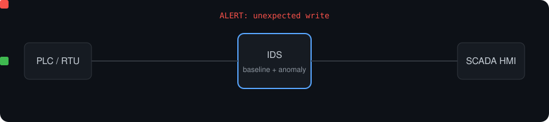
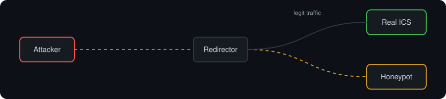
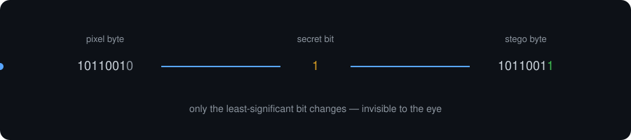

<h1 align="center">NK · SudoNK</h1>

  

<h3 align="center">Cybersecurity · ICS/SCADA Security · Blockchain · Python</h3>

  
  
  <!-- add LinkedIn / TryHackMe / HackTheBox badges here -->

---

## 🧑‍💻 About Me

- 🎓 Cybersecurity & Blockchain Technology student
- 🛡️ I build defensive tooling: intrusion detection, honeypots and network forensics
- 🏭 Especially interested in **industrial control system (ICS/SCADA)** security and Modbus traffic
- 🐧 Daily-driving Arch Linux
- 🤝 **Open to cybersecurity internships and collaboration**

---

## 🚀 Featured Projects

### 🏭 [SCADA-IDS](https://github.com/SudoNK/SCADA-IDS)

**Intrusion detection for SCADA.** Modbus TCP traffic analysis, basic asset discovery and anomaly detection against a learned baseline.

`Python` `Modbus TCP`

### 🍯 [Industrial-HoneyPot](https://github.com/SudoNK/Industrial-HoneyPot)

**Deception for ICS.** Modbus traffic analysis, attack detection and intelligent redirection of attackers into a honeypot.

`Python`

### 🖼️ [HEIDI](https://github.com/SudoNK/HEIDI)

**Hide secrets in plain sight.** Hides and extracts messages inside images using LSB steganography.

`Python`

### 🔍 More

- 🕵️ [Network-Forensics-Tool](https://github.com/SudoNK/Network-Forensics-Tool): offline packet inspection and suspicious-activity detection
- 🚨 [MiniIDS](https://github.com/SudoNK/MiniIDS): lightweight IDS built on Scapy
- 📐 [2D-shapes-Area-Perimeter-App](https://github.com/SudoNK/2D-shapes-Area-Perimeter-App): geometry calculator in KivyMD

---

## 🛠️ Tech Stack

  

**⛓️ Currently Learning:** Blockchain security

---

  <b>💬 Let's connect! Always up for conversations about security, ICS and blockchain.</b>

